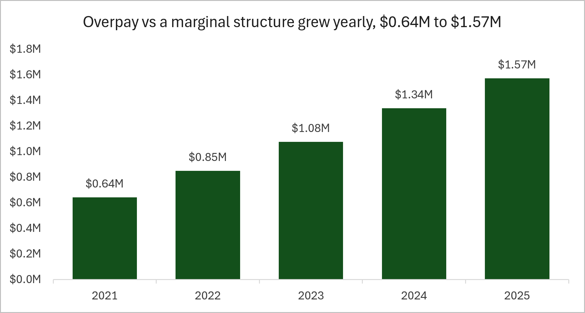
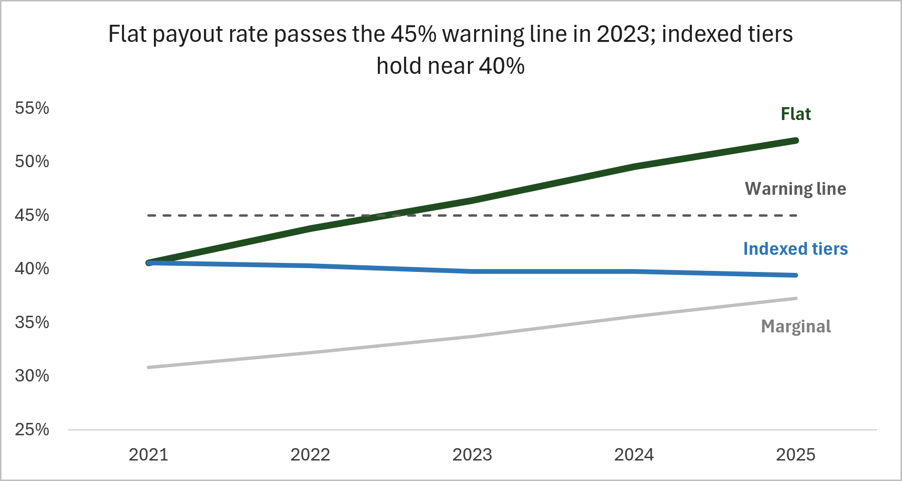
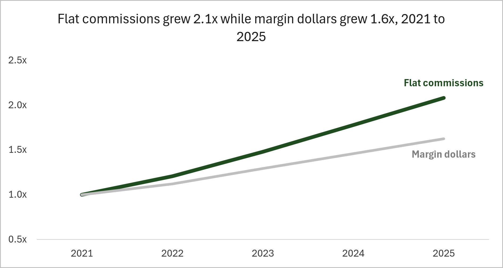

# Quota and Commission Model (09_quota_model)

**Business question:** Does the flat-tier commission structure overpay, and if so, where and by how much?

**Short answer:** Yes. The flat structure paid about **$5.5 million** more than a marginal structure would have over 2021 to 2025, which is 27% of the $20.1 million paid in commissions. The annual overpay grew every year, from $0.64 million to $1.57 million. I recommend indexing the tier edges to the company growth target, which holds the payout rate near 40% instead of 52% and saves about $3.1 million over five years.

A one-page summary is in [`docs/09_quota_model_case_study.pdf`](deliverables/09_quota_model_case_study.pdf), and the model itself is in [`Excel/09_quota_model.xlsx`](Excel/09_quota_model.xlsx).

## Findings

### 1. The overpay grows every year

Overpay is the flat commission minus the commission a marginal structure (rate applied only to the dollars inside each tier) would have paid on the same sales. It rose from $0.64M in 2021 to $1.57M in 2025. Most of it is structural: the "cliff" windfall at tier edges explains only about 8% of it.

### 2. The flat payout rate crosses the 45% warning line in 2023

Payout rate is commission divided by margin dollars. The flat plan goes from 40.6% in 2021 to 52.0% in 2025 and passes the 45% warning line in 2023 (46.4%). Indexed tiers end at 39.4% and the marginal structure at 37.3%. At the rep level, Region 1 has the highest overpay per rep-month and reached the 60% maximum rate in 2025.

### 3. Commissions outgrew the business

Commissions rose 108% from 2021 to 2025 while margin dollars rose 62%. Quota attainment stayed between 97% and 100%, so the extra pay did not come from reps beating the targets.

## Recommendation

Index the tier edges to the company growth target (15% per year). The payout rate stays near 40% instead of climbing to 52%, and the plan saves about $3.1 million over five years compared with the current structure. Pay still rises when reps beat the growth target.

### Limits

- The data is synthetic and has no behavioral response: reps do not change how they sell when the plan changes, so the $3.1 million is an estimate, not a forecast.
- Indexing does not remove the cliffs at tier edges or the flat-rate overpay.
- Actual growth in the data came out at about 13% against the 15% indexing target, which lowers the indexed rate slightly.
- Quota is context only. It has no effect on rep pay in this model.
- A marginal structure is the next plan I would review.

## Scenario

A fictional automotive replacement-parts company with 4 regions and 20 sales seats (49 reps over five years because of turnover) pays commission on margin dollars. The rate is set by the rep's monthly net sales tier (25%, 33%, 42%, 51% or 60%) and applies to all margin dollars, not only the dollars above the threshold. The rules are in [`docs/rules_spec.md`](docs/rules_spec.md).

## How it was built

1. `python/generate_data.py` creates the synthetic sales data (60 months, Jan 2021 to Dec 2025, seed 42).
2. `SQL/01_create_tables.sql` builds the SQL Server schema.
3. `python/load_data.py` loads the CSVs into the database.
4. `SQL/02_validate_load.sql` checks the load against the generator's totals.
5. `SQL/03_rep_month_derivation.sql` aggregates completed net sales by rep by month.
6. `python/export_rep_month.py` writes `data/processed/rep_month.csv` (1,200 rows).
7. `Excel/09_quota_model.xlsx` holds the model. Excel techniques used: an Excel Table with structured references, named ranges tied to an Assumptions sheet, XLOOKUP, SUMPRODUCT, SUMIFS and COUNTIFS, and conditional formatting.

### Workbook tabs

| Tab | What it holds |
|---|---|
| README | Business question, finding, tab guide, color key |
| Assumptions | Every rule and rate, each tagged to `rules_spec.md` |
| Rep_month | One row per rep per month, with commission and overpay calculations |
| Sales and margins | Net sales and margin dollars by region and year |
| Commissions | Flat commission dollars and rates by region and year |
| Overpay | Overpay by region and year, and per rep-month |
| Quota | Net sales, quota and attainment by region and month |
| Cliff exposure | Rep-months within 5% of each tier edge and the cost |
| Scenarios | Flat vs indexed vs marginal plans: commissions, rates, savings |
| Checks | Tie-outs to the SQL totals and between tabs (all PASS) |
| Charts | Data behind the three charts |

## To reproduce

You need Python (pandas, SQLAlchemy, pyodbc) and a local SQL Server instance. Run the scripts in the order above and update the connection string in `python/load_data.py` for your server.

## Data note

All data is synthetic. The data generator (`generate_data.py`) was written with AI assistance (Claude). The SQL, the loader and export scripts, the Excel model and the analysis are my own work.

## Tools

SQL Server (SSMS), Python (pandas, SQLAlchemy), Excel.